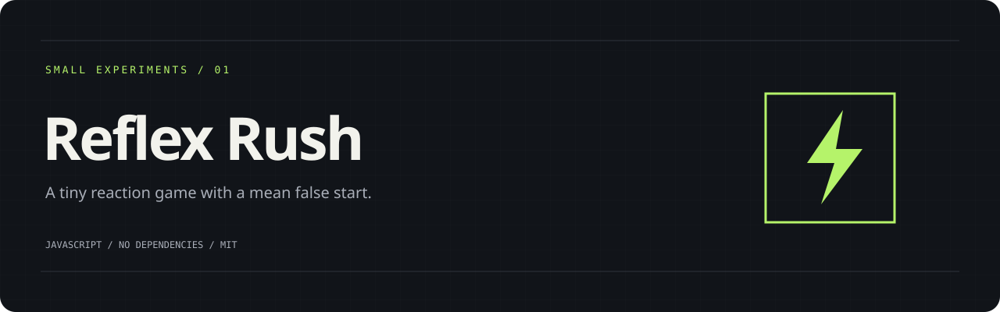

# Reflex Rush

A five-round reaction game. It waits a random 1.4–4 seconds before turning green, keeps completed rounds after a false start, and scores the session by its median.

## Run it

From this folder:

```sh
python3 -m http.server 8000
```

Open [localhost:8000](http://localhost:8000). On Windows, use `py -m http.server 8000` if Python is installed through the launcher. Serve one project per port. No install step, CDN or API key.

Click the pad or use Space. If the pad has keyboard focus, Enter works too. Start the next round at your own pace. Switching tabs cancels a live round; a background tab never counts as a slow reaction.

## Under the hood

The game is a small state machine: idle → waiting → go → between → done. Only the go state accepts a result. A single lucky round cannot replace the median of five; your best session median is stored locally.

`src/core.mjs` holds the testable logic. `src/app.mjs` connects it to the page. Styles and assets live in this repository; the app makes no external requests. A local server is required because the scripts use ES modules.

## Check it

Node.js 20 or newer is only needed for development checks:

```sh
npm run check
npm test
```

The same commands run on pushes and pull requests through GitHub Actions.

## A few limits

Browser scheduling, screen refresh and input devices add latency. Treat the numbers as game scores, not medical or competitive measurements.

## A next experiment

Try a best-of-three mode or graph the spread between rounds.

## License

[MIT](LICENSE)
